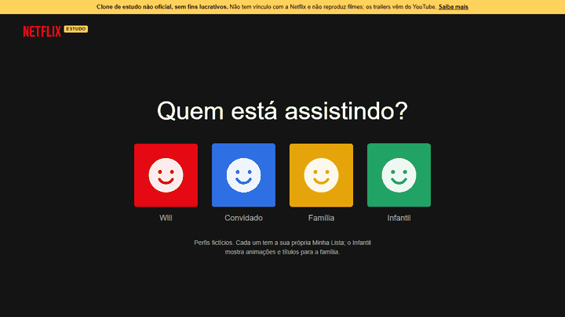

<p align="center">
  <a href="https://will-ifes.github.io/netflixReactClone/">
    
  </a>
</p>

# Clone de interface de streaming · React e TypeScript

Interface no estilo da Netflix com dados reais do TMDB: perfis, destaque, fileiras por gênero, ficha de cada título com trailer, Minha Lista e busca. Começou num curso da B7Web e foi refeito em 2026 com stack atual, testes e acessibilidade.

**React 19 · TypeScript · Vite 8 · Vitest · API do TMDB** · [Ver online](https://will-ifes.github.io/netflixReactClone/)

> [!IMPORTANT]
> **Clone de estudo não oficial e sem fins lucrativos.** Não tem vínculo, patrocínio ou autorização da Netflix, e Netflix é marca registrada da Netflix, Inc. O logotipo é escrito em texto, sem usar a imagem oficial. A página não reproduz filmes: os trailers são vídeos públicos do YouTube. Dados e imagens vêm do TMDB; este produto usa a API do TMDB, mas não é endossado nem certificado por ele.

<p align="center">
  <a href="https://will-ifes.github.io/netflixReactClone/">
    
  </a>
  <br />
  <sub>Clique na demonstração para explorar a interface publicada.</sub>
</p>

## O que dá para fazer

- **Perfis:** "Quem está assistindo?" com quatro perfis fictícios. Cada um tem a própria Minha Lista; o **Infantil** troca as fileiras por animação, família, desenhos e séries infantis.
- **Destaque:** um título sorteado entre os que têm imagem de fundo e sinopse, com **Assistir trailer**, **Mais informações** e **+**.
- **Fileiras:** oito categorias carregadas em paralelo, com rolagem por toque, trackpad, teclado ou setas.
- **Ficha do título:** nota, ano, duração ou temporadas, gêneros, sinopse e elenco com fotos, num `<dialog>` que fecha com Esc ou clicando fora.
- **Trailer:** escolhe o melhor vídeo do TMDB (trailer oficial em português antes de inglês) e toca pelo `youtube-nocookie.com`, só quando você clica.
- **Minha Lista:** salva no navegador, separada por perfil, com fileira própria na tela inicial e aba no menu.
- **Busca:** filmes e séries a partir de duas letras, com espera de 350 ms entre teclas e estados de vazio e erro.

## O que mudou na revisão

| Antes | Depois |
| --- | --- |
| React 18, Vite 3 e JavaScript, com MUI e Emotion instalados só para duas setas | React 19, Vite 8 e TypeScript `strict`, com `@phosphor-icons/react`; 0 vulnerabilidades |
| 8 requisições em sequência e nenhuma tratada; a página ficava branca se o TMDB falhasse | `Promise.allSettled` em paralelo; uma fileira que falha some, e a falha total mostra **Tentar de novo** |
| Fileira de ação com o título "Em Alta" repetido | Títulos corrigidos e definidos num só lugar |
| O sorteio do destaque nunca escolhia o último item e às vezes caía num título sem imagem | Sorteio entre todos os títulos com fundo e sinopse, testado |
| "Assistir" e "Minha Lista" levavam para `/watch123` e `/list/add123`, que não existem | Trailer real, ficha completa e Minha Lista funcionando |
| Setas eram `div`s sem teclado; deslocamento por `margin-left` calculado à mão | Botões com nome acessível e rolagem nativa com `scroll-snap` |
| Logo, avatar e GIF de carregamento vindos de três sites de terceiros | Logotipo em texto, avatares em CSS e esqueleto de carregamento próprio |
| Nenhum aviso de que era um clone | Faixa de aviso fixa, seção "Sobre este projeto", README e `noindex` |
| Sem testes | 12 testes com Vitest e Testing Library, com a API simulada |

**Validação:** axe-core sem violações nas telas de perfis, início, busca e ficha, em 375 e 1366 px. Sem rolagem horizontal. Trailer conferido tocando num navegador real.

## Por dentro do código

| Código | Responsabilidade |
| --- | --- |
| [`src/api/tmdb.ts`](src/api/tmdb.ts) | Cliente tipado: fileiras, detalhes com vídeos e elenco, busca, escolha do trailer e do destaque. |
| [`src/hooks/useAssincrono.ts`](src/hooks/useAssincrono.ts) | Estados de carregando, sucesso e erro, descartando respostas antigas. |
| [`src/hooks/useMinhaLista.ts`](src/hooks/useMinhaLista.ts) e [`usePerfil.ts`](src/hooks/usePerfil.ts) | Lista por perfil e perfil escolhido, salvos no navegador. |
| [`src/components/Detalhes`](src/components/Detalhes) | Ficha do título e player do trailer. |
| [`src/components/Fileira`](src/components/Fileira) | Fileira com rolagem nativa, cards e grade da busca. |

## Executar localmente

Requer Node.js 20.19 ou superior.

```bash
git clone https://github.com/Will-Ifes/netflixReactClone.git
cd netflixReactClone
npm install
npm run dev
```

O projeto usa a chave pública da API do TMDB que veio do curso. Para usar a sua, crie um `.env.local` com `VITE_TMDB_KEY=sua_chave` (gere em [themoviedb.org](https://www.themoviedb.org/settings/api)). Num site estático a chave sempre fica visível no navegador.

| Comando | O que faz |
| --- | --- |
| `npm run dev` | Servidor de desenvolvimento |
| `npm test` | Testes com Vitest |
| `npm run lint` | ESLint |
| `npm run build` | Typecheck e build de produção |

---

Mantido por **Will Oliveira** · [Perfil](https://github.com/Will-Ifes) · [LinkedIn](https://www.linkedin.com/in/wildemberg-de-jesus-oliveira/)
